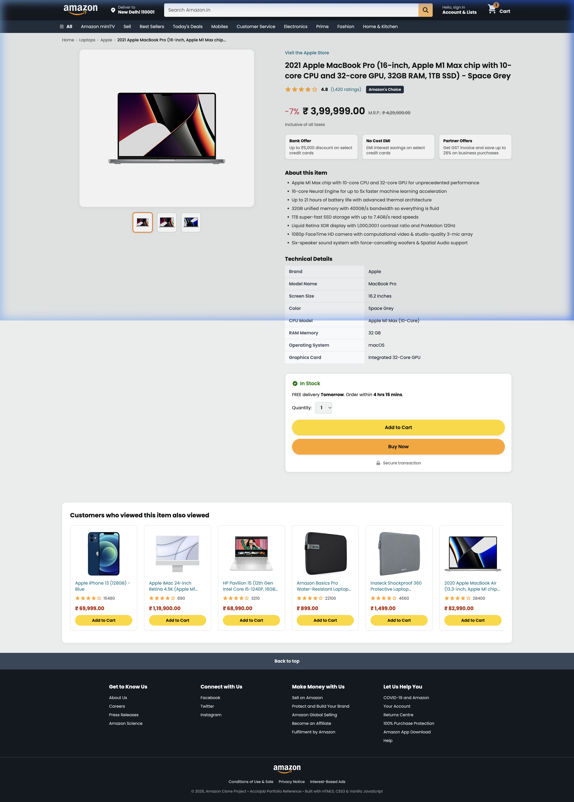
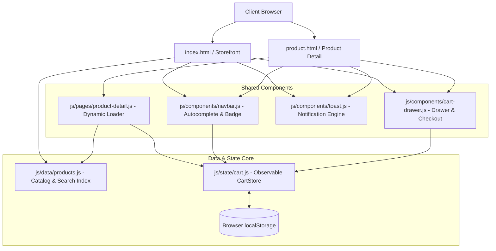

# Amazon Storefront Clone

> **A high-fidelity, responsive e-commerce storefront web application built with semantic HTML5, modern vanilla CSS3, and reactive ECMAScript (ES2022). Features real-time search autocomplete, dynamic product pages, persistent cart state management, and simulated checkout.**

[](https://github.com/vanimendiratta/Amazon/actions/workflows/ci.yml)
[](LICENSE)
[](tests/)
[](js/)
[](responsive.css)

---

## 📸 Application Preview

| **Storefront Gateway & Search Autocomplete** | **Slide-Out Cart Drawer & Threshold Meter** |
|:---:|:---:|
|  |  |

| **Homepage Gateway** | **Dynamic Product Detail Page** |
|:---:|:---:|
|  |  |

---

## ⚠️ Educational Project Disclaimer

> **Notice**: This repository is an independent open-source educational demonstration and UI/UX case study. It is **not** affiliated with, authorized, maintained, sponsored, or endorsed by Amazon.com, Inc. or any of its subsidiaries. All product names, logos, trademarks, and registered trademarks referenced are the property of their respective owners. The checkout, payment, and order processing flows are simulated client-side demonstrations using mock data; no real-world financial transactions or physical orders take place.

---

## 🎯 Project Overview & Problem Statement

Building an authentic, performant e-commerce experience requires more than static HTML templates. This project bridges the gap between basic mockup designs and production-grade frontend engineering by implementing:
- **Instant Search & Autocomplete**: Substring matching with live dropdown results and keyboard navigation.
- **State Persistence**: A reactive shopping cart store synchronized across browser tabs using `localStorage` and custom events.
- **Dynamic Routing & Product Hydration**: URL query parameter handling (`product.html?id=...`) to dynamically render individual product specifications, gallery switchers, and customer ratings.
- **Responsive Layout System**: Adaptive grids transitioning cleanly across mobile, tablet, and ultra-wide screens without third-party CSS bloat.

---

## ✨ Features

### 🛒 E-Commerce & Shopping Cart
- **Reactive Cart State Engine**: Supports adding items, incrementing/decrementing quantities, individual item deletion, and full cart clearing.
- **Slide-Out Cart Drawer**: Animated right-hand drawer accessible from any page with background blur and keyboard (`Escape`) dismiss.
- **Dynamic Free Shipping Meter**: Visual progress bar tracking progress toward the ₹499 free shipping threshold.
- **Simulated Checkout Flow**: Full checkout modal simulating shipping address verification, payment method selection, duplicate submission prevention, and order placement with unique generated tracking IDs.
- **Multi-Tab Sync**: Automatically updates the cart across open tabs using the `storage` event.

### 🔍 Search & Product Discovery
- **Live Search Autocomplete**: Instant search as you type, highlighting matched tokens in title, brand, and category with strict HTML escaping to prevent DOM injection.
- **Keyboard Navigation**: Navigate suggestions with `ArrowUp`, `ArrowDown`, and select with `Enter`.
- **Comprehensive Product Catalog**: Over 20 structured products across Laptops, Smartphones, Tablets, Groceries, Appliances, and Fashion.

### 📱 Product Detail Experience (`product.html`)
- **Dynamic URL Hydration**: Parses `?id=<product_id>` to render custom titles, pricing, discounts, bank offers, and bullet points with safe fallback on unknown product IDs.
- **Interactive Multi-Angle Gallery**: Switch between product angles via gallery thumbnail buttons.
- **Technical Specs Table**: Structured key-value table for device hardware specifications.
- **Smart Recommendations**: Dynamic "Customers who viewed this item also viewed" carousel with quick-add actions.

### 🎨 UI/UX & Accessibility (a11y)
- **Fluid Responsive Layout**: Seamless scaling from 320px mobile viewports up to 4K displays.
- **Non-blocking Toast Notifications**: Micro-interactions providing immediate visual feedback for cart modifications.
- **Accessible Foundations**: WCAG AA color contrast, high-visibility keyboard focus rings, semantic HTML5 landmarks (`<header>`, `<nav>`, `<main>`, `<section>`, `<footer>`), and descriptive `aria-label` tags.

---

## 🏗️ Architecture & Data Flow



For in-depth architectural patterns, sequence diagrams, and design decisions, see [docs/ARCHITECTURE.md](docs/ARCHITECTURE.md).

---

## 🛠️ Technology Stack

| Layer | Technology | Purpose |
|---|---|---|
| **Markup** | HTML5 (Semantic) | Document hierarchy, landmarks, metadata, accessibility |
| **Styling** | Vanilla CSS3 | Custom properties (CSS variables), Grid, Flexbox, media queries |
| **Client Logic** | Vanilla ECMAScript (ES2022) | Observable store pattern, DOM event delegation, URLSearchParams |
| **Data Storage** | Web Storage API | `localStorage` cart state persistence across reloads & tabs |
| **Testing** | Node.js Test Runner (`node --test`) | Built-in zero-dependency unit and integration test runner |
| **CI/CD** | GitHub Actions | Automated linting and test execution on push / PR |

---

## 🚀 Quickstart & Local Installation

### Prerequisites
- Any modern web browser (Chrome, Firefox, Safari, Edge).
- Optional for tests: [Node.js](https://nodejs.org/) (v18.0.0 or higher).

### 1. Clone the Repository
```bash
git clone https://github.com/vanimendiratta/Amazon.git
cd Amazon
```

### 2. Run Locally
Because this project uses vanilla web standards with zero build step, you can run it immediately with any static server:

```bash
# Option A: Using Python 3 (Installed by default on macOS/Linux)
python3 -m http.server 3000

# Option B: Using Node / npm
npm run dev
```

Visit [`http://localhost:3000`](http://localhost:3000) in your browser.

---

## 🧪 Testing & Code Quality

The repository includes an extensive, automated test suite covering cart operations, storage corruption resilience, boundary threshold calculations, catalog lookups, search edge cases, and simulated multi-tab synchronization.

```bash
# Run all unit and integration tests
npm test

# Run syntax and linter validation
npm run lint
```

### Verified Test Results
```text
✔ CartStore - starts empty (0.81ms)
✔ CartStore - adds items and computes subtotal correctly (0.23ms)
✔ CartStore - updates quantity and auto-removes on quantity <= 0 (0.18ms)
✔ CartStore - removes item explicitly (0.09ms)
✔ CartStore - computes free shipping threshold correctly (0.15ms)
✔ CartStore - calculates savings compared to original price (0.06ms)
✔ CartStore - persists and restores from storage (0.14ms)
✔ CartStore - clears cart (0.08ms)
✔ CartStore - handles corrupted JSON in storage gracefully (0.66ms)
✔ CartStore - filters out malformed or null items in storage (0.15ms)
✔ CartStore - caps maximum quantity per item at 99 (0.15ms)
✔ CartStore - handles invalid or non-numeric quantity inputs safely (0.12ms)
✔ CartStore - threshold boundary condition at exactly 498 and 499 (0.22ms)
✔ Catalog - has valid products with required schema (0.76ms)
✔ Catalog - getProductById works for valid and invalid IDs (0.09ms)
✔ Catalog - getProductsByCategory filters accurately (0.29ms)
✔ Catalog - searchProducts performs case-insensitive and multi-field search (0.25ms)
✔ Catalog - getProductById handles edge case arguments safely (0.06ms)
✔ Catalog - formatPriceINR formats Indian Rupees properly (11.56ms)
✔ E2E Simulation - Search product -> Add to cart -> Calculate totals -> Checkout simulation (0.96ms)
✔ E2E Simulation - Low-value order incurs standard delivery charge (0.09ms)
✔ E2E Simulation - Prevents checkout operations when cart is empty (0.12ms)
✔ E2E Simulation - Multi-tab storage sync simulation (0.11ms)

ℹ tests 23 | pass 23 | fail 0 | duration_ms 54.90ms
```

---

## 📁 Repository Structure

```text
.
├── .github/
│   └── workflows/
│       └── ci.yml               # Automated CI test & lint pipeline
├── docs/
│   ├── images/                  # Authentic application screenshots
│   │   ├── cart_drawer.png
│   │   ├── homepage.png
│   │   ├── product_detail.png
│   │   └── search_autocomplete.png
│   ├── ARCHITECTURE.md          # System design & sequence diagrams
│   ├── IMPLEMENTATION_PLAN.md   # Prioritized tasks & acceptance criteria
│   └── PROJECT_AUDIT.md         # Comprehensive engineering audit report
├── js/
│   ├── components/
│   │   ├── cart-drawer.js       # Slide-out drawer & checkout simulation
│   │   ├── navbar.js            # Live search autocomplete & badge sync
│   │   └── toast.js             # Notification engine
│   ├── data/
│   │   └── products.js          # Catalog database & search helpers
│   ├── pages/
│   │   └── product-detail.js    # Dynamic detail page controller
│   └── state/
│       └── cart.js              # Reactive CartStore & localStorage
├── tests/
│   ├── cart.test.js             # Cart CRUD & threshold unit tests
│   ├── catalog.test.js          # Catalog schema & search unit tests
│   └── integration.test.js      # E2E simulated checkout flows
├── favicon.svg                  # Vector SVG Amazon-style icon
├── index.html                   # Storefront gateway page
├── product.html                 # Dynamic product detail page
├── style.css                    # Main design system & storefront styles
├── product.css                  # Product page styles & specs table
├── responsive.css               # Media queries & fluid layouts
├── package.json                 # Project configuration & npm scripts
├── CHANGELOG.md                 # Version history & release notes
├── CONTRIBUTING.md              # Contribution guide & standards
├── SECURITY.md                  # Security policy & reporting
├── LICENSE                      # MIT License
└── README.md                    # Project documentation
```

---

## 🛡️ Security & Limitations

- **Client-Side Simulation**: Payment and checkout flows are simulated for portfolio and demonstration purposes; no real credit card or personal data is collected or transmitted.
- **XSS Mitigation**: Dynamic DOM rendering employs safe text assignment and sanitized parameter parsing.
- **Zero Runtime Dependencies**: No unvetted third-party npm packages are executed in the browser runtime.

---

## 🗺️ Roadmap & Future Enhancements

- [ ] User review submission modal with star rating inputs.
- [ ] Multi-currency switcher (USD, EUR, GBP, INR).
- [ ] Dark Mode theme toggle.
- [ ] User wish list persistence.

---

## 📄 License & Maintainer

Distributed under the **MIT License**. See [`LICENSE`](LICENSE) for details.

Developed with ❤️ by **[Vani Mendiratta](https://github.com/vanimendiratta)**.
