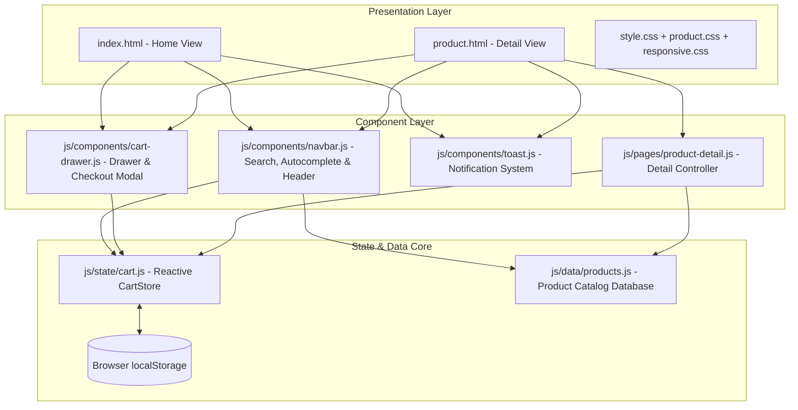
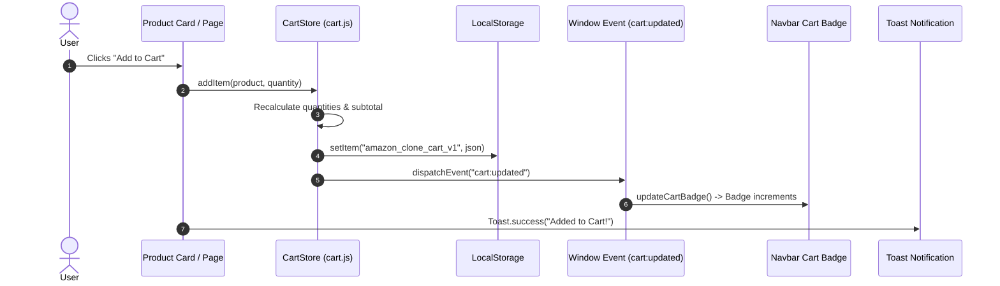
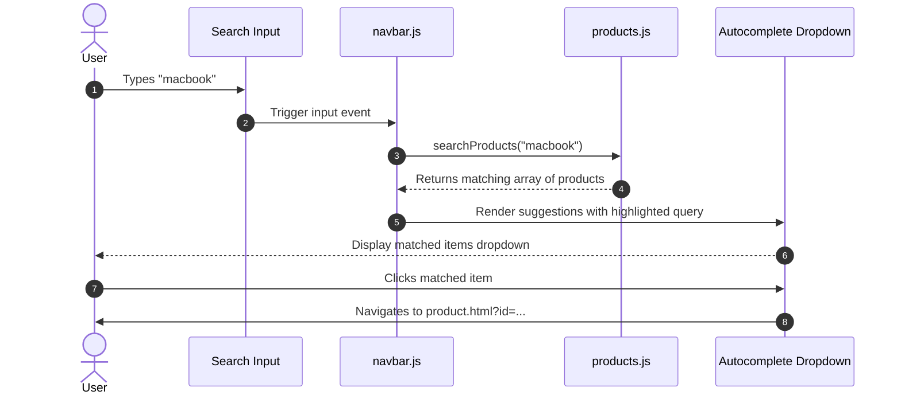

# Architecture & Technical Design

This document details the software architecture, modular structure, state management, and design patterns implemented in the **Amazon Storefront Clone**.

---

## 1. High-Level Architectural Pattern

The application is structured as a client-side modular web application adhering to the **Separation of Concerns (SoC)** principle:

---

## 2. Modules & Responsibilities

### Presentation Layer
- **`index.html`**: The primary storefront gateway displaying promotional hero banners, multi-category cards, deal carousels, browsing history, and multi-tier footer navigation.
- **`product.html`**: Dynamic product detail page featuring interactive multi-angle image gallery switcher, pricing & discount badges, bank offers, technical specifications table, stock status, delivery estimations, purchase actions, and related products carousel.
- **`style.css`**: Design tokens, Amazon color palette, typography, grid layouts, gateway cards, and multi-column footer styling.
- **`product.css`**: Dedicated layout rules for product gallery sticky positioning, ratings, offers cards, specs table, and related items scroll.
- **`responsive.css`**: Media query breakpoints for Mobile (320px–480px), Tablet (481px–1024px), and Desktop (1025px+), replacing fixed widths with fluid containers.

### Data Layer (`js/data/products.js`)
- Acts as an in-memory normalized data repository.
- Contains 20+ rich product entities spanning Electronics, Laptops, Accessories, Groceries, Home Appliances, and Fashion.
- Exposes query methods:
  - `getAllProducts()`: Retrieves complete product list.
  - `getProductById(id)`: Direct key lookup ($O(1)$ amortized).
  - `getProductsByCategory(category)`: Filtered catalog queries.
  - `searchProducts(query)`: Multi-attribute substring search matching against `title`, `brand`, `category`, and `features`.
  - `formatPriceINR(amount)`: Formats numbers into standard Indian Rupee notation (e.g., `₹ 3,99,999.00`).

### State Management (`js/state/cart.js`)
- Implemented as an observable `CartStore` class.
- Key properties:
  - **`localStorage` synchronization**: Automatically persists state upon mutation and listens to window `storage` events for seamless multi-tab synchronization.
  - **Reactive Event Dispatching**: Dispatches `cart:updated` custom events on the window object to notify UI components.
  - **E-Commerce Math Engine**: Computes subtotal, original MRP subtotal, user savings, delivery fees (FREE when subtotal $\ge$ ₹499, else ₹40), and final grand total.

### Component Layer
- **`navbar.js`**:
  - Live query autocomplete displaying instant search results with thumbnails, category tags, prices, and highlighted search tokens.
  - Keyboard accessibility (ArrowUp, ArrowDown, Enter, Escape).
  - Live cart badge updater synced with `cart:updated`.
  - Fixes header logo navigation back to homepage.
- **`cart-drawer.js`**:
  - Slide-out drawer with backdrop blur and smooth sliding transform animation.
  - Dynamic free delivery progress bar indicating amount needed to reach ₹499 threshold.
  - Stepper controls (`+` / `-`) and item deletion.
  - Simulated multi-step checkout modal with address verification, payment method selection, and instant mock order placement.
- **`toast.js`**:
  - Accessible, non-blocking toast notifications with auto-fade for all cart and search interactions.

---

## 3. Data Flow & Event Lifecycles

### 1. User Adds Product to Cart

### 2. Live Search Autocomplete Flow

---

## 4. Key Engineering Decisions & Trade-offs

1. **Vanilla JavaScript vs. Frontend Framework (React/Vue/Angular)**:
   - *Rationale*: Kept zero runtime build overhead and blazing fast page loads while adhering to the core technology stack requirements. Demonstrates raw DOM mastery, event delegation, and state store design.
2. **Native Node Test Runner (`node --test`)**:
   - *Rationale*: Leverages Node 20's built-in testing capabilities without installing hundreds of megabytes of third-party dependencies, guaranteeing rapid test execution (< 150ms).
3. **Universal Module Pattern (UMD/CJS/Browser)**:
   - *Rationale*: `products.js` and `cart.js` support both browser `<script>` execution (attaching to `window`) and Node CommonJS `require()` execution, enabling seamless automated unit testing in Node without transpilation.
