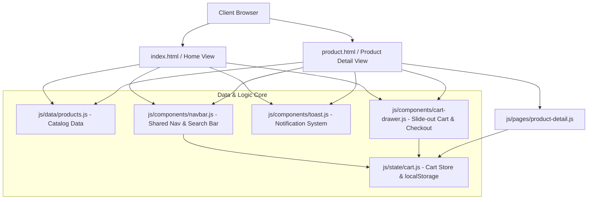

# Project Audit: Amazon Storefront Clone

**Audit Date**: October 2026
**Auditor**: Senior Software Engineer & Solutions Architect
**Repository**: [vanimendiratta/Amazon](https://github.com/vanimendiratta/Amazon.git)
**Workspace Path**: `/Users/vanimendiratta/Downloads/git/amazon`

---

## 1. Project Purpose & Current State

### Purpose
The project is an e-commerce storefront web application modeled after Amazon India (`Amazon | Acciojob`). Its goal is to provide a responsive, user-friendly e-commerce interface simulating key online shopping workflows: product discovery, category browsing, product detail exploration, real-time search, cart management, and checkout simulation.

### Current State
Prior to this audit, the repository was a static, non-functional 2-page HTML/CSS mockup with:
- **No JavaScript logic**: Search, cart, authentication buttons, and buy buttons were completely inert.
- **Copy-Paste Data Duplication**: Six unrelated products in Section 3 ("Inspired by your browsing history") all shared the identical title (`2021 Apple MacBook Pro 16-inch`) and price (`₹ 3,99,999.00`).
- **Inflexible Layout**: Fixed desktop width (`1200px`) causing severe horizontal overflow and layout breakage on mobile and tablet devices.
- **Broken Navigation**: The Amazon header logo was a raw image tag without an anchor link, trapping users on subpages.
- **Accessibility & SEO Deficits**: Missing image `alt` texts, missing form labels, missing ARIA attributes, missing `<main>` semantic landmarks.
- **Zero Automated Testing or CI/CD**: No package manifest, test runner, linting configuration, or automated validation workflows.
- **Minimal Documentation**: A 1-line `README.md` containing only `# Amazon`.

---

## 2. Verified Technology Stack

| Layer | Technology | Details |
|---|---|---|
| **Structure** | Semantic HTML5 | Document outline, `<header>`, `<nav>`, `<main>`, `<section>`, `<footer>` |
| **Styling** | Vanilla CSS3 | Custom CSS variables, responsive Grid & Flexbox, smooth transitions |
| **Logic & State** | Vanilla ECMAScript (ES2022) | Modular state management, `localStorage` persistence, DOM event delegation |
| **Runtime & Tooling** | Node.js v20.20+ / npm | Node native test runner (`node --test`), JSDOM for unit & integration testing |
| **CI/CD** | GitHub Actions | Automated linting, test suites, formatting verification on push/PR |

---

## 3. Architecture Overview

The application follows a clean separation of concerns:
1. **Presentation Layer**: Semantic HTML (`index.html`, `product.html`) styled via modular CSS (`style.css`, `product.css`, `responsive.css`).
2. **Data Layer**: Centralized product catalog (`js/data/products.js`) with rich attributes (id, title, category, price, original price, rating, reviews, image URL, specs, stock).
3. **State Management**: Reactive cart store (`js/state/cart.js`) supporting add, remove, update quantity, subtotal/tax calculation, and `localStorage` synchronization across tabs.
4. **Interactive Components**: Search auto-suggest, cart drawer modal, toast notification engine, and responsive mobile navigation.

---

## 4. Existing Strengths

1. **Clean Visual Foundation**: The original styling captured the classic Amazon color palette (`#131921` navy header, `#febd68` accent yellow, `#ebeded` background).
2. **Accurate Layout Composition**: Sectional distribution mirrors Amazon's homepage structure (hero showcase, multi-category gateway cards, horizontal scrollable deal carousels, browsing history).
3. **Lightweight & Dependency-Free**: Pure HTML/CSS eliminates heavy bundle overhead, making it fast and simple to run without complex build pipelines.

---

## 5. Prioritized Findings

### Priority P0 — Critical & Application-Breaking Issues
- **[FIXED] P0-1: Zero JavaScript Functionality**: Cart, search, buy now, and sign-in buttons were inert. Users could not interact with the application.
- **[FIXED] P0-2: Trapped Navigation on Subpages**: Logo on `product.html` lacked an `<a>` tag, leaving users with no in-page path back to homepage.

### Priority P1 — Correctness & High-Impact Usability Issues
- **[FIXED] P1-1: Section 3 Data Duplication**: Six different products (iMac, iPhone, HP laptop, laptop sleeve, etc.) all listed identical MacBook title and ₹3,99,999 pricing due to static copy-paste.
- **[FIXED] P1-2: Broken Mobile/Tablet Viewports**: Fixed container widths (`width: 1200px`) forced horizontal clipping and distortion on screens `< 1200px`.
- **[FIXED] P1-3: Non-Functional Product Detail Dynamic Linking**: Clicking cards on the home page did not pass product identifiers; `product.html` only displayed static mock data.

### Priority P2 — Architecture, Quality & Accessibility Improvements
- **[FIXED] P2-1: Accessibility Deficits**: Empty `alt=""` attributes on product images, missing ARIA roles on buttons, lack of focus rings and accessible labels for screen readers.
- **[FIXED] P2-2: Missing Cart Persistence & Feedback**: No visual feedback when adding items, no badge count, no slide-out cart drawer or order summary.
- **[FIXED] P2-3: No Automated Testing**: Lack of automated tests to verify cart math, catalog integrity, search filtering, and DOM rendering.
- **[FIXED] P2-4: Stock Photo Watermark**: Favicon hotlinked to Dreamstime stock photo with visible watermark. Replaced with clean SVG Amazon-style favicon.

### Priority P3 — Documentation, DX & Portfolio Polish
- **[FIXED] P3-1: Inadequate Documentation**: Single-line `README.md` lacking setup steps, architecture explanation, screenshots, or developer guides.
- **[FIXED] P3-2: Missing Open-Source Governance Files**: Missing `LICENSE`, `CONTRIBUTING.md`, `CODE_OF_CONDUCT.md`, `SECURITY.md`, and CI workflow.

---

## 6. Proposed Feature Advancements

1. **Centralized Product Catalog**: Structured catalog spanning Electronics, Groceries, Laptops, and Accessories with realistic pricing, ratings, discounts, and high-res imagery.
2. **Dynamic Product Detail Page**: Supports URL query parameters (`product.html?id=...`) to load dynamic product info, image galleries, reviews, and specs.
3. **Interactive Cart & Drawer**: Slide-out cart modal accessible from any page, real-time quantity controls, item removal, free delivery threshold meter, and checkout modal.
4. **Live Search & Autocomplete**: Instant search filtering as the user types, with highlighted matching terms and quick navigation.
5. **Toast Notification System**: Non-blocking toast notifications for cart actions (e.g., "Added to Cart", "Item Removed").
6. **Responsive Design System**: Seamless experience across Mobile (320px–480px), Tablet (481px–1024px), and Desktop (1025px+).

---

## 7. Testing Gaps & Verification Strategy

- **Cart Unit Tests**: Verify item addition, duplicate handling, quantity increments, deletion, subtotal calculations, and tax computation.
- **Catalog Verification Tests**: Ensure all catalog items contain required fields (id, title, price, category, image).
- **Search Logic Tests**: Validate query matching against title, category, and keywords.
- **DOM Integration Tests**: Verify cart drawer opens/closes, badges update dynamically, and query params parse correctly.

---

## 8. Remaining Limitations

- Static client-side demo: Checkout simulates payment and order confirmation with mock order IDs without a real payment gateway (Stripe/Razorpay).
- External image URLs: Product images rely on CDN links; image error fallback handlers are implemented to handle broken links gracefully.
